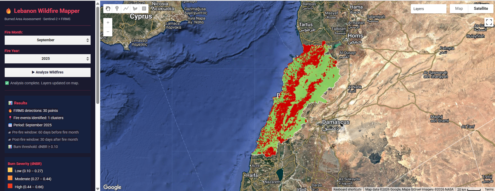
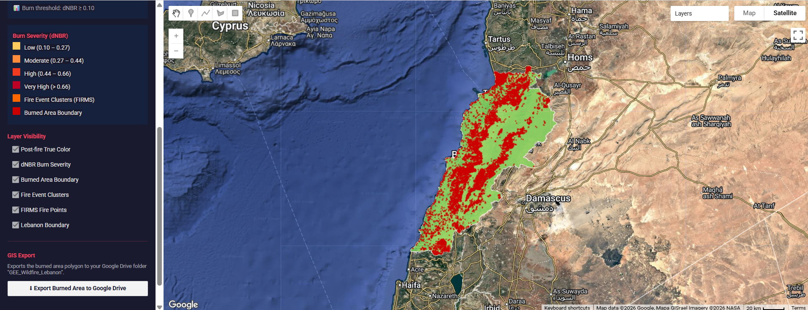

# Geospatial AI for Wildfire Mapping in Lebanon

Semi-automated burned area assessment using Google Earth Engine, combining NASA FIRMS active fire points with Sentinel-2 imagery.
Burn severity is computed as the differenced Normalized Burn Ratio (dNBR) between pre-fire and post-fire composites.

🔗 **Try it:** [Open the script in Google Earth Engine](https://code.earthengine.google.com/09f0f9111949235df15d43745da35368)

> You'll need a Google account registered for Earth Engine to run the script.

## Screenshots

